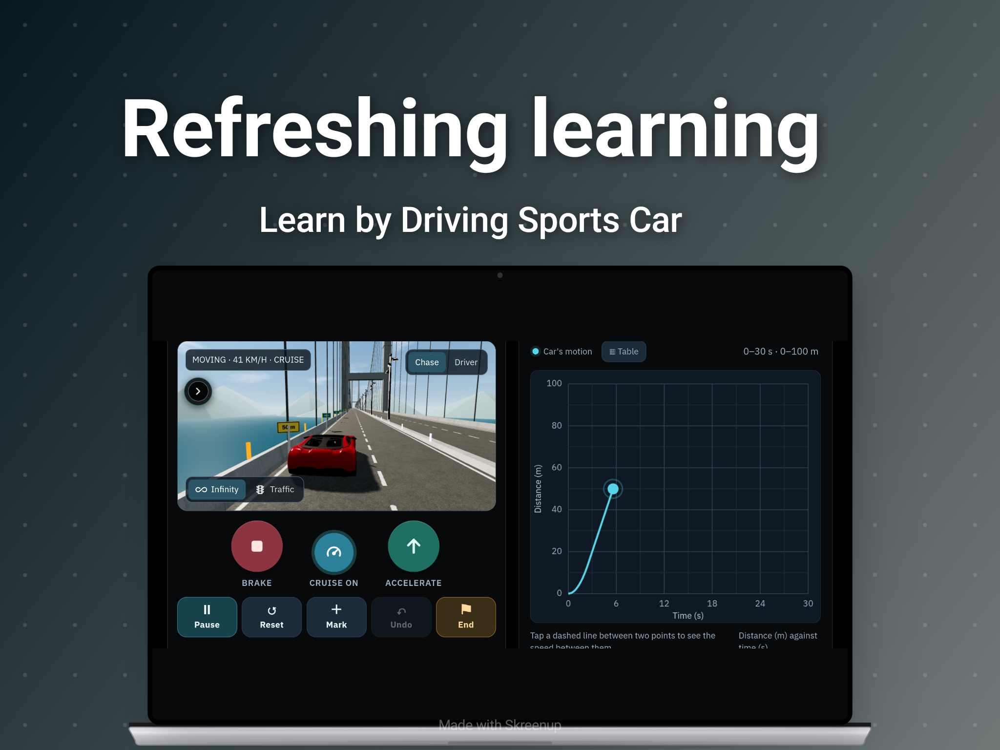
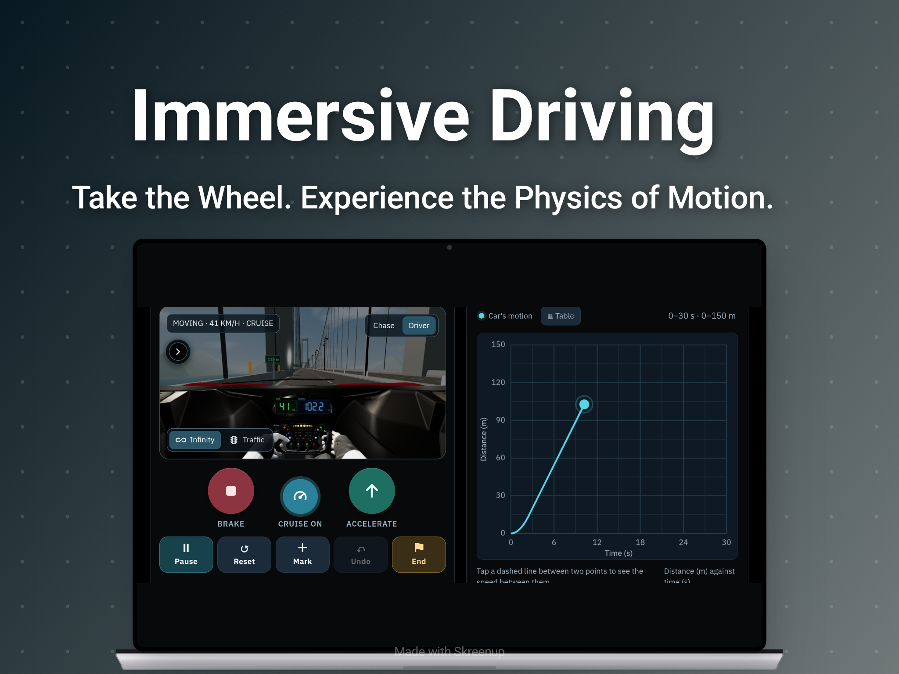
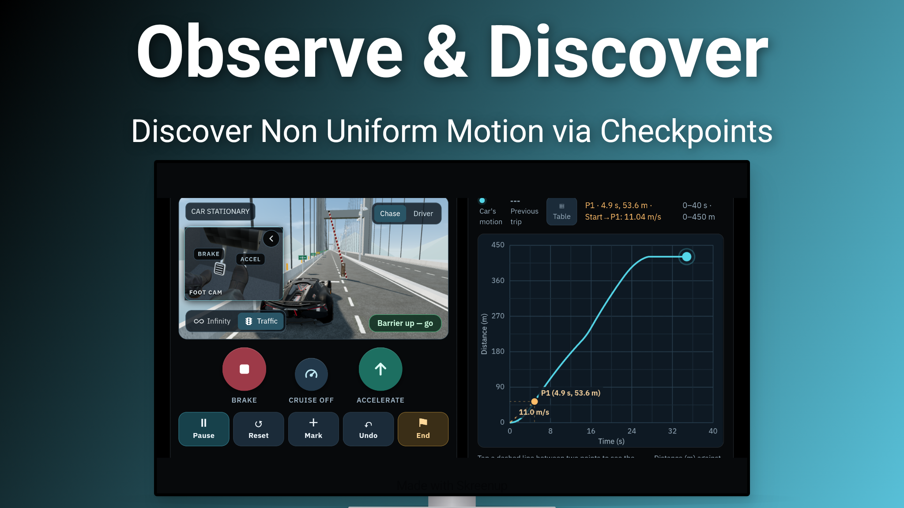
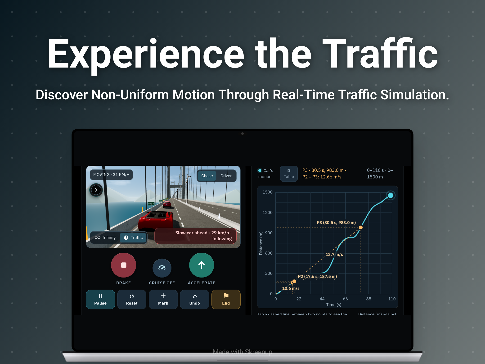

<p align="center">
  
</p>

<h1 align="center">🏎️ Impetus Kinetrix</h1>

<p align="center"><em>Mapping Motion through time</em></p>

<p align="center"><a href="https://qronox-kinetrix.stark-kodex.workers.dev"><strong>Drive the Simulation</strong></a></p>

<p align="center">
  <a href="#-about">About</a> ·
  <a href="#-the-car">Car</a> ·
  <a href="#%EF%B8%8F-road-modes">Road modes</a> ·
  <a href="#-reading-the-data">Data</a> ·
  <a href="#-concepts-covered">Concepts</a> ·
  <a href="#-controls">Controls</a> ·
  <a href="#-teaching-model">Teaching model</a> ·
  <a href="#-project-structure">Structure</a> ·
  <a href="#-3d-models">3D Models</a> ·
  <a href="#-credits">Credits</a>
</p>

---

## 📖 About

An interactive driving simulator for teaching **distance**, **time** and **speed** through the **distance–time graph**. Drive a car across a suspension bridge with the accelerator and brake while a live graph traces every metre against every second: **steeper** when faster, **flat** when stopped, **curved** when speeding up or slowing down.

Built for classroom smart panels; works on laptops and phones too.

---

## 📸 Screenshots

<table width="100%">
  <tr>
    <td width="50%" align="center">
      
      <br><sub><b>Refreshing learning · Learn by driving</b></sub>
    </td>
    <td width="50%" align="center">
      
      <br><sub><b>Immersive driving · Take the wheel</b></sub>
    </td>
  </tr>
  <tr>
    <td width="50%" align="center">
      
      <br><sub><b>Observe &amp; discover · Checkpoints</b></sub>
    </td>
    <td width="50%" align="center">
      
      <br><sub><b>Experience the traffic · Non-uniform motion</b></sub>
    </td>
  </tr>
  <tr>
    <td width="50%" align="center">
      
      <br><sub><b>Your journey, your calculations · Average speed</b></sub>
    </td>
    <td width="50%" align="center">
      
      <br><sub><b>Understand · Experience · Calculate</b></sub>
    </td>
  </tr>
</table>

---

## 🚗 The Car

A concept car drives in the left lane of an endless suspension bridge over open water.

| View | What you see |
|:--|:--|
| **Chase** | Camera behind the car; distance boards every 10 m and reflector posts every 6 m. |
| **Driver** | Through the driver's eyes. Green LEDs show **speed (km/h)**, blue LEDs the **odometer (m)**. **Drag** to look around; ⟲ or double-tap faces forward. |
| **Foot cam** | Top-left mini view of the footwell: the right foot presses the **accelerator** and moves across to the **brake**. |

---

## 🛣️ Road Modes

### ♾️ Infinity
An open road. Hold a steady speed (or use cruise) to draw **uniform motion**: a straight line.

### 🚦 Traffic
Three hold-ups, one after another with a **10 s cooldown**, then the cycle repeats:

1. **Checkpoint**: stop at the white line, wait 3 s, the barrier lifts.
2. **Traffic light**: red → amber → green after 3 s.
3. **Slow traffic**: follow a slow car for about 12 s until it pulls away.

An **auto-brake** stops the car in time and a banner shows what's next. The graph shows **non-uniform motion**: flat parts, curves and changing slopes.

---

## 📊 Reading the Data

| Panel | What it shows |
|:--|:--|
| **Distance–time graph** | Distance (m) vs time (s), live; axes rescale as the trip grows. |
| **Marked points** | **Mark** drops a point; tap the line between two points for the speed between them. |
| **Table** | Each marked point with time, distance and speed since the previous one. |
| **Stats** | Elapsed time, motion state and speed in m/s with km/h (× 18/5). |
| **Journey summary** | **End** shows total distance, total time and **average speed = total distance ÷ total time**, plus the speed of each part. |
| **Averaging check** | Why averaging the part speeds gives the wrong answer: each part lasted a different time. |
| **Previous trip** | After **Reset**, the last trip stays as a grey dashed line. |

---

## 🌱 Concepts Covered

| Area | Concepts |
|:--|:--|
| Distance and time | Distance travelled · Elapsed time · Odometer only counts up |
| Speed | Speed = distance ÷ time · m/s ↔ km/h (× 18/5, × 5/18) · Average speed |
| Motion | Rest · Uniform · Non-uniform · Speeding up · Slowing down |
| Graphs | Slope = speed · Steeper = faster · Flat = stopped · Curve = changing speed |

---

## 🧭 Controls

| Control | Action |
|:--|:--|
| ⬆ Accelerate / ⏹ Brake (hold) | Speed up / slow down |
| ◔ Cruise | Hold the current speed |
| ▶ Start · ⏸ Pause · ↺ Reset | Run, freeze or restart the trip |
| ＋ Mark · ↶ Undo · ⚑ End | Add/remove points · open the journey summary |
| Chase · Driver · ⟲ | Switch camera · face forward |
| ♾️ Infinity · 🚦 Traffic | Switch road mode |
| ‹ Foot cam · ▦ Table · ⛶ Full screen | Hide foot cam · show table · fill the screen |

---

## 🔬 Teaching Model

A deliberately **simplified** model (no gears, engine curves or air resistance):

| Quantity | Value |
|:--|:--|
| Acceleration | 4.6 m/s² (0–100 km/h in about 6 s) |
| Braking | 7.0 m/s² |
| Top speed | 38 m/s (about 137 km/h) |
| Coasting | 0.15 m/s² + 0.03 m/s² per m/s of speed |
| Auto-brake (Traffic) | Up to 3.0 m/s² |

Distance travelled only increases, so the graph never slopes down.

---

## 💻 Technology

HTML · CSS · JavaScript · Three.js · glTF · Cloudflare Workers

A **single-file build** (`Impetus-Kinetrix.html`, every model inside) runs offline with no server. Without 3D support, a simple drawn road is shown and the simulator still works.

---

## 📁 Project Structure

```
├── index.html          Page layout
├── style.css           Styling
├── app.js              Simulation, physics, graph and 3D scene
├── three.min.js        Three.js r128
├── GLTFLoader.js       glTF model loader
└── assets/
    ├── banner-impetus.png
    ├── models/         3D models (.glb)
    └── screenshots/
```

Serve the folder with any web server (opening `index.html` directly blocks the models). For offline use, open the single-file build.

---

## 🧩 3D Models

| | Asset | Model | Creator | Licence |
|:-:|:--|:--|:--|:--|
| 🏎️ | Car | [FREE Concept Car 004](https://sketchfab.com/3d-models/free-concept-car-004-public-domain-cc0-4cba124633eb494eadc3bb0c4660ad7e) | Unity Fan | Sketchfab Standard ¹ |
| 🌉 | Bridge | [Car_ Animation](https://sketchfab.com/3d-models/car--animation-cb83f35f5a5942b7a5e7756366797b6a) | lawanya B | CC BY 4.0 |
| 🎮 | Steering wheel | [Race Steering Wheel – Lamborghini Essenza SCV12](https://sketchfab.com/3d-models/race-steering-wheel-lamborghini-essenza-scv12-7fd7543c58994fd09344d761978eecfa) | SDC PERFORMANCE | CC BY 4.0 |
| 🧍 | Driver | [Connor RK900 – Detroit Become Human](https://sketchfab.com/3d-models/connor-rk900-detroit-become-human-623e3f52b7da4116a4576f38479eaaaf) | Q.SARDOR | CC BY 4.0 |
| 🚦 | Traffic light | [Traffic Light](https://sketchfab.com/3d-models/traffic-light-240630f6755d43d6bb0af54f7f2d135b) | miwaVV | CC BY 4.0 |
| 🚧 | Barrier | [Checkpoint Stop Road Barrier](https://sketchfab.com/3d-models/checkpoint-stop-road-barrier-lowpoly-security-cd64979fc9774d729ac31e443a9f3935) | 00amza | CC BY 4.0 |
| 🚙 | Traffic cars | [Traffic Car Pack](https://sketchfab.com/3d-models/traffic-car-pack-916a8b149ae24d8b8c9cf12d4a1c64d4) | JUSTGAME | CC BY 4.0 |
| ⏲️ | Dash cluster | [Digital Speedometer](https://sketchfab.com/3d-models/digital-speedometer-48ebbd6321b44617b32e7bfa91c81e2d) | ROY | CC BY 4.0 |

<sub>Creators keep ownership. Models were simplified and resized; the car's own wheel and display and the bridge's cars were removed.<br>
¹ Title says CC0, but the file lists the Sketchfab Standard licence. Check before reusing.</sub>

---

## 🤖 Credits

- OpenAI: Initial code implementation
- Claude: Subsequent code architecture
- Perplexity: Scientific validation and debugging
- GitHub & Codeberg: Repository
- Cloudflare Workers: Hosting

---

## 📜 License

Code: **MIT** ([LICENSE](LICENSE)). 3D models keep their own licences. Release history: [CHANGELOG](CHANGELOG.md).

---

<p align="center">
  <b>Repository</b>: GitHub &amp; Codeberg &nbsp;&nbsp;|&nbsp;&nbsp; <b>Hosting</b>: Cloudflare
</p>
