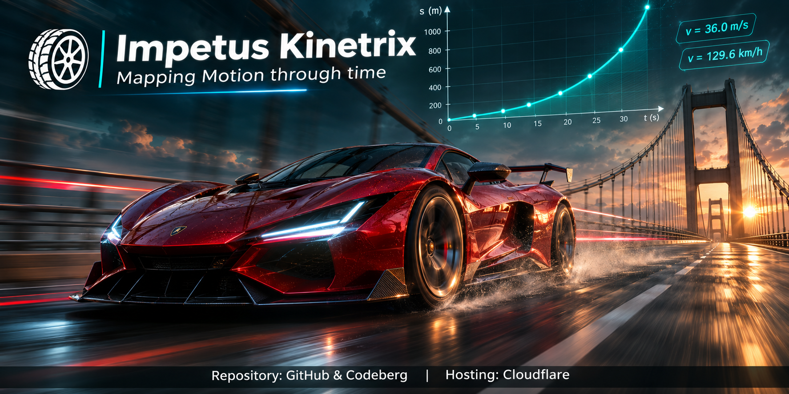
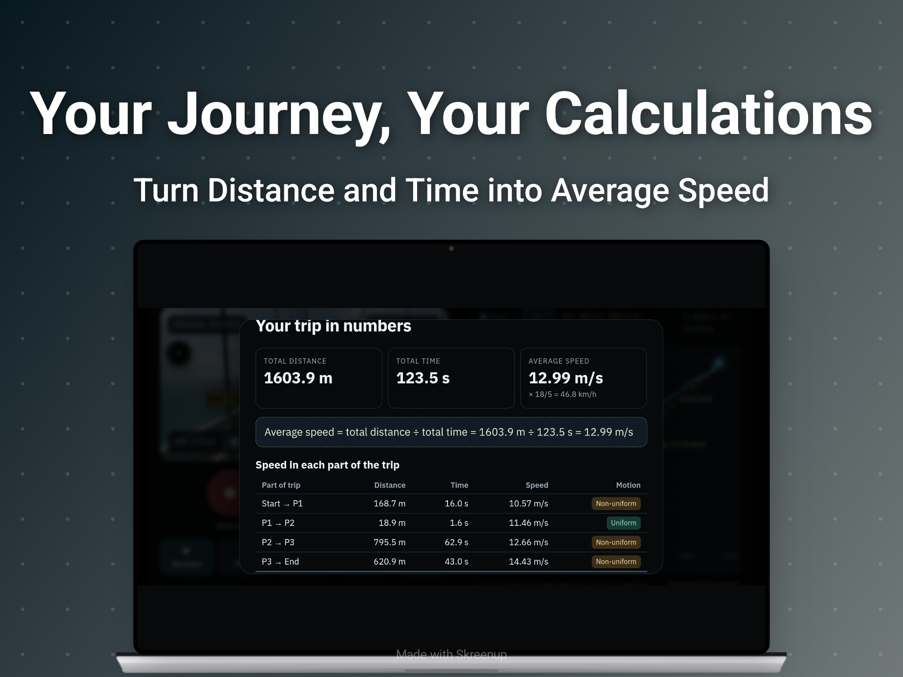
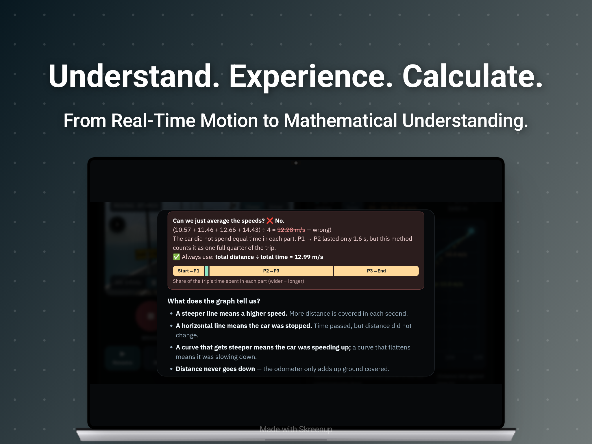

<p align="center">
  
</p>

<h1 align="center">Impetus Kinetrix</h1>

<p align="center"><em>Mapping Motion through time</em></p>

<p align="center"><a href="https://qronox-kinetrix.stark-kodex.workers.dev"><strong>Drive the Simulation</strong></a></p>

<p align="center">
  <a href="#about">About</a> ·
  <a href="#screenshots">Screenshots</a> ·
  <a href="#the-car">Car</a> ·
  <a href="#road-modes">Road modes</a> ·
  <a href="#reading-the-data">Data</a> ·
  <a href="#concepts-covered">Concepts</a> ·
  <a href="#controls">Controls</a> ·
  <a href="#teaching-model">Teaching model</a> ·
  <a href="#technology">Technology</a> ·
  <a href="#3d-models">3D Models</a> ·
  <a href="#credits">Credits</a>
</p>

---

## About

**Drive a sports car. Watch physics draw itself.**

An interactive 3D simulator for teaching distance, time and speed. Press the pedals and a live **distance–time graph** traces every metre against every second: **steeper** when faster, **flat** when stopped, **curved** when speeding up or slowing down. Built for classroom smart panels, laptops and phones.

---

## Screenshots

<table width="100%">
  <tr>
    <td width="50%" align="center">
      
      <br><sub><b>Refreshing learning</b></sub>
    </td>
    <td width="50%" align="center">
      
      <br><sub><b>Immersive driving</b></sub>
    </td>
  </tr>
  <tr>
    <td width="50%" align="center">
      
      <br><sub><b>Observe &amp; discover</b></sub>
    </td>
    <td width="50%" align="center">
      
      <br><sub><b>Experience the traffic</b></sub>
    </td>
  </tr>
  <tr>
    <td width="50%" align="center">
      
      <br><sub><b>Your journey, your calculations</b></sub>
    </td>
    <td width="50%" align="center">
      
      <br><sub><b>Understand · Experience · Calculate</b></sub>
    </td>
  </tr>
</table>

---

## The Car

A concept car on an endless suspension bridge over open water.

| Chase | Driver | Foot cam |
|:--|:--|:--|
| Behind the car, with distance boards every 10 m | Through the driver's eyes: LED speed and odometer, free look and a rear-view mirror | The driver's feet on the accelerator and brake |

---

## Road Modes

| Infinity | Traffic |
|:--|:--|
| An open road. Hold a steady speed for **uniform motion**: a straight line. | A checkpoint, a traffic light and a slow car, 10 s apart, on repeat. Every stop and restart draws **non-uniform motion**. |

---

## Reading the Data

- **Live graph:** distance against time; the axes grow with the trip.
- **Marked points:** select the line between two points to see the speed between them.
- **Journey summary:** average speed = total distance ÷ total time, and why averaging part speeds is wrong.
- **Previous trip:** after Reset, the last trip stays on the graph for comparison.

---

## Concepts Covered

`Distance` · `Time` · `Speed = distance ÷ time` · `m/s ↔ km/h` · `Average speed` · `Rest` · `Uniform motion` · `Non-uniform motion` · `Slope = speed`

---

## Controls

| Drive | Record | View |
|:--|:--|:--|
| Accelerate · Brake · Cruise | Start · Reset · Mark · Undo · End | Chase · Driver · Infinity · Traffic · Table · Full screen |

---

## Teaching Model

A deliberately simplified car: **4.6 m/s²** acceleration (0–100 km/h in about 6 s), **7.0 m/s²** braking, **38 m/s** top speed and gentle coasting. Distance only increases, so the graph never slopes down.

---

## Technology

HTML · CSS · JavaScript · Three.js · glTF · Cloudflare

```
index.html · style.css · app.js · three.min.js · GLTFLoader.js
assets/  banner/ · models/ · screenshots/
```

Host the folder on any web server, or open the single-file build (`Impetus-Kinetrix.html`) offline.

---

## 3D Models

| Asset | Model | Creator | Licence |
|:--|:--|:--|:--|
| Car | [FREE Concept Car 004](https://sketchfab.com/3d-models/free-concept-car-004-public-domain-cc0-4cba124633eb494eadc3bb0c4660ad7e) | Unity Fan | Sketchfab Standard ¹ |
| Bridge | [Car_ Animation](https://sketchfab.com/3d-models/car--animation-cb83f35f5a5942b7a5e7756366797b6a) | lawanya B | CC BY 4.0 |
| Steering wheel | [Race Steering Wheel – Lamborghini Essenza SCV12](https://sketchfab.com/3d-models/race-steering-wheel-lamborghini-essenza-scv12-7fd7543c58994fd09344d761978eecfa) | SDC PERFORMANCE | CC BY 4.0 |
| Driver | [Connor RK900 – Detroit Become Human](https://sketchfab.com/3d-models/connor-rk900-detroit-become-human-623e3f52b7da4116a4576f38479eaaaf) | Q.SARDOR | CC BY 4.0 |
| Traffic light | [Traffic Light](https://sketchfab.com/3d-models/traffic-light-240630f6755d43d6bb0af54f7f2d135b) | miwaVV | CC BY 4.0 |
| Barrier | [Checkpoint Stop Road Barrier](https://sketchfab.com/3d-models/checkpoint-stop-road-barrier-lowpoly-security-cd64979fc9774d729ac31e443a9f3935) | 00amza | CC BY 4.0 |
| Traffic cars | [Traffic Car Pack](https://sketchfab.com/3d-models/traffic-car-pack-916a8b149ae24d8b8c9cf12d4a1c64d4) | JUSTGAME | CC BY 4.0 |
| Dash cluster | [Digital Speedometer](https://sketchfab.com/3d-models/digital-speedometer-48ebbd6321b44617b32e7bfa91c81e2d) | ROY | CC BY 4.0 |

<sub>Creators keep ownership; models were simplified and resized.<br>¹ Title says CC0, but the file lists the Sketchfab Standard licence. Check before reusing.</sub>

---

## Credits

| Contributor | Role |
|:--|:--|
| OpenAI | Initial code implementation |
| Claude | Code architecture |
| Perplexity | Scientific validation and debugging |
| GitHub & Codeberg | Repository |
| Cloudflare | Hosting |

---

## License

Code: **MIT** ([LICENSE](LICENSE)) · 3D models keep their own licences · [Changelog](CHANGELOG.md)
