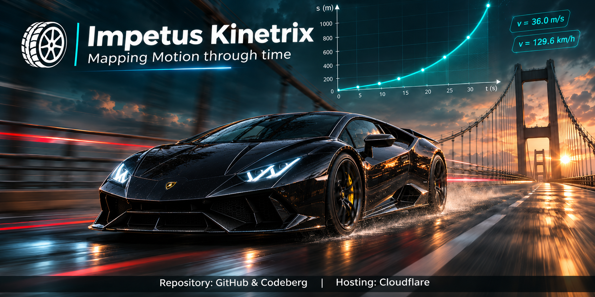

  

<h1 align="center">Impetus Kinetrix</h1>

<em>Mapping Motion through time</em>

<a href="https://qronox-kinetrix.stark-kodex.workers.dev"><strong>Launch the Simulator</strong></a>

  <a href="#about">About</a> ·
  <a href="#screenshots">Screenshots</a> ·
  <a href="#features">Features</a> ·
  <a href="#controls">Controls</a> ·
  <a href="#technology">Technology</a> ·
  <a href="#credits">Credits</a> ·
  <a href="#releases">Releases</a> ·
  <a href="#license">License</a>

---

## About

Impetus Kinetrix is a 3D driving simulator for teaching **distance, time and speed** through the **distance–time graph**. Students drive a Lamborghini across an endless suspension bridge while a live graph traces every metre against every second.

The graph shows the physics as it happens: **steeper** when faster, **flat** when stopped, **curved** when speeding up or slowing down. Marked points and a journey summary turn the drive into calculations of speed and average speed. Built for classroom smart panels, laptops and phones.

---

## Screenshots

<table width="100%">
  <tr>
    <td width="50%" align="center">
      
       <b>1 · Innovative Learning </b>
    </td>
    <td width="50%" align="center">
      
       <b>2 · Immersive Driving</b>
    </td>
  </tr>
  <tr>
    <td width="50%" align="center">
      
       <b>3 · Observe &amp; Discover</b>
    </td>
    <td width="50%" align="center">
      
       <b>4 · Calculate Journey</b>
    </td>
  </tr>
  <tr>
    <td width="50%" align="center">
      
       <b>5 · Journey Summary</b>
    </td>
    <td width="50%" align="center">
      
       <b>6 · Experience, Calculate
        </b>
    </td>
  </tr>
</table>

---

## Features

| Feature | What You See | Try This |
|:--|:--|:--|
| **Chase view** | The car from behind, distance boards every 10 m | Hold the accelerator and watch the graph steepen |
| **Driver view** | Through the driver's eyes: race wheel, LED speed and odometer | Drag to look around (up to about 100° each way) |
| **Foot cam** | The driver's feet on a carbon pedal box | Press brake and accelerator and watch the foot move |
| **Infinity mode** | An open road | Use cruise to draw a straight line: uniform motion |
| **Traffic mode** | A checkpoint, a traffic light and a slow car, 10 s apart | Watch flat parts and curves appear: non-uniform motion |
| **Journey summary** | Total distance, total time and the speed of each part | Check why averaging part speeds gives the wrong answer |

**Concepts:** Distance · Time · Speed = distance ÷ time · m/s ↔ km/h · Average speed · Rest · Uniform motion · Non-uniform motion · Slope = speed

---

## Controls

| Control | Function |
|:--|:--|
| Accelerate · Brake (hold) | Speed up · slow down |
| Cruise | Hold the current speed |
| Pause · Reset | Freeze the clock · start a new trip (the last one stays as a ghost line) |
| Mark · Undo | Add or remove a point on the graph |
| End | Open the journey summary |
| Chase · Driver · Infinity · Traffic | Switch camera or road mode |

---

## Technology

HTML · CSS · JavaScript · Three.js · glTF · Cloudflare

<b>Project files</b>

| File | Contents |
|:--|:--|
| `index.html` | Page layout |
| `style.css` | Styling |
| `app.js` | Physics, graph, traffic and 3D scene |
| `three.min.js` · `GLTFLoader.js` | Three.js r128 and its glTF loader |
| `assets/models/` | 3D models (.glb) |
| `assets/banner/` · `assets/screenshots/` | README images |

A single-file offline build (`Impetus-Kinetrix.html`) is attached to each release.

---

## Credits

| Contributor | Role |
|:--|:--|
| Sai Prasad, M.Sc. Agri. Entomology, ASRB NET | Project Designer |
| Claude Opus 5.5 | Development |
| OpenAI GPT Luna 5.7 | Image Generation |
| Perplexity Sonar 2 | Scientific Reasoning |

<b>3D models</b>

| Asset | Model | Creator | Licence |
|:--|:--|:--|:--|
| Car | FREE Lamborghini Terzo Millennio | Noredine Allam ¹ | Not recorded ¹ |
| Bridge | [Car_ Animation](https://sketchfab.com/3d-models/car--animation-cb83f35f5a5942b7a5e7756366797b6a) | lawanya B | CC BY 4.0 |
| Steering wheel | [Race Steering Wheel – Lamborghini Essenza SCV12](https://sketchfab.com/3d-models/race-steering-wheel-lamborghini-essenza-scv12-7fd7543c58994fd09344d761978eecfa) | SDC PERFORMANCE | CC BY 4.0 |
| Driver | [Connor RK900 – Detroit Become Human](https://sketchfab.com/3d-models/connor-rk900-detroit-become-human-623e3f52b7da4116a4576f38479eaaaf) | Q.SARDOR | CC BY 4.0 |
| Traffic light | [Traffic Light](https://sketchfab.com/3d-models/traffic-light-240630f6755d43d6bb0af54f7f2d135b) | miwaVV | CC BY 4.0 |
| Barrier | [Checkpoint Stop Road Barrier](https://sketchfab.com/3d-models/checkpoint-stop-road-barrier-lowpoly-security-cd64979fc9774d729ac31e443a9f3935) | 00amza | CC BY 4.0 |
| Traffic cars | [Traffic Car Pack](https://sketchfab.com/3d-models/traffic-car-pack-916a8b149ae24d8b8c9cf12d4a1c64d4) | JUSTGAME | CC BY 4.0 |
| Dash cluster | [Digital Speedometer](https://sketchfab.com/3d-models/digital-speedometer-48ebbd6321b44617b32e7bfa91c81e2d) | ROY | CC BY 4.0 |

Models were simplified and resized; creators keep ownership under their licences. 
¹ Creator taken from the model file; source link and licence not recorded.

<b>Libraries and fonts</b>

| Component | Licence |
|:--|:--|
| Three.js r128 · GLTFLoader | MIT |
| IBM Plex Sans · IBM Plex Mono · Roboto (Google Fonts) | SIL OFL 1.1 · Apache 2.0 |

---

## Releases

| Release | Title | Date |
|:--|:--|:--|
| RC II | 3D Revamp | 2026-11-14 |
| RC I | Initial release (QronoX Kinetrix) | — |

Full history: [CHANGELOG](CHANGELOG.md)

---

## License

Code: **MIT** ([LICENSE](LICENSE)) · 3D models keep their own licences.

GitHub · Codeberg &nbsp;|&nbsp; Hosted on Cloudflare

